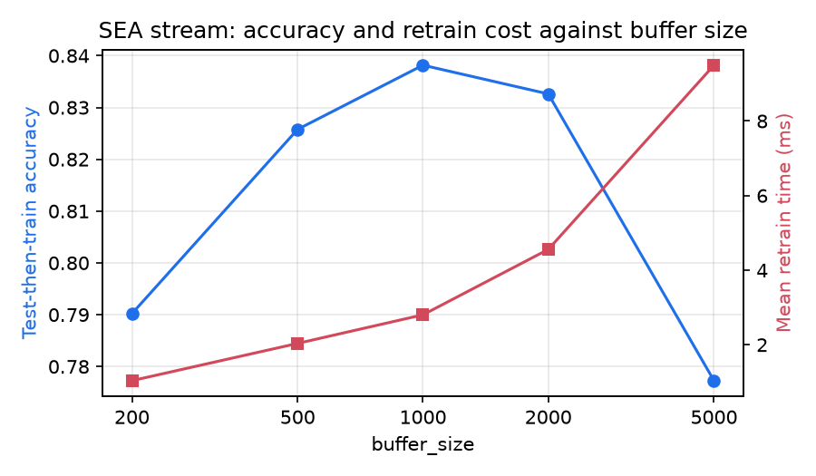

# NumCompute Stream

A streaming, decision-tree-based machine learning toolkit written in plain
Python, NumPy and matplotlib, built for **Assignment 2.2** (individual work).

It extends the group's NumCompute package (Assignment 2.1) so that data can
arrive in chunks. Every component learns incrementally: preprocessing,
statistics, metrics and the model all have `partial_fit` or `update`.
The model is a single CART decision tree that retrains on a buffer of recent
samples, and a `visualise` module plots the metrics as the stream goes on.

No external ML or data libraries (scikit-learn, pandas, PyTorch) are used. The
only dependencies are NumPy and matplotlib.

**Author:** Majharul Islam (a3202747)

**Branches:** `main` holds the group's Assignment 2.1 code, unchanged. This
branch (`majhar-individual`) adds the `numcompute_stream/` package. It starts as
a copy of `numcompute/`, so `numcompute/` stays exactly as the group submitted it.

---

## Contents

1. [Installation](#installation)
2. [How to run](#how-to-run)
3. [Project structure](#project-structure)
4. [Quick start](#quick-start)
5. [API overview](#api-overview)
6. [Design choices](#design-choices)
7. [Testing](#testing)
8. [Performance](#performance)

---

## Installation

You need Python 3.10 or newer.

```bash
# from the project root
python -m venv .venv
source .venv/bin/activate        # Windows: .venv\Scripts\activate
python -m pip install -e ".[dev]"
```

This installs `numcompute_stream` (and the original `numcompute`) in editable
mode, plus `pytest`, `jupyter` and `ruff`. The package needs `numpy>=1.24` and
`matplotlib>=3.7`.

## How to run

| Task | Command |
|---|---|
| Run the unit tests | `python -m pytest` |
| Run the streaming benchmarks | `python benchmark/stream_benchmarks.py` (about 20 s) |
| Re-run the streaming demo | `jupyter nbconvert --to notebook --execute --inplace demo/stream_demo.ipynb` |
| Open the demo interactively | `jupyter notebook demo/stream_demo.ipynb` |
| Check code style | `python -m ruff check .` |

The benchmark script prints its tables, saves them to
`benchmark/stream_results.md`, and writes two charts to `benchmark/figures/`.

## Project structure

```
while-false-break/
├── numcompute_stream/       the Assignment 2.2 package
│   ├── tree.py              DecisionTreeClassifier (buffered retraining), best_split
│   ├── stream.py            StreamTrainer: test-then-train loop with per-chunk logging
│   ├── visualise.py         matplotlib plots of metrics over time and of predictions
│   ├── preprocessing.py     scalers, imputer and one-hot encoder, all with partial_fit
│   ├── stats.py             StreamingStats.update_stats, StreamingHistogram, RunningStats
│   ├── metrics.py           streaming accuracy, precision, recall, F1, MSE, confusion, AUC
│   ├── pipeline.py          Pipeline / FeatureUnion / ColumnSelector with partial_fit
│   ├── io.py                CSV reader with chunked streaming (iter_csv_chunks)
│   └── ...                  sort_search, rank, optim, utils, benchmarking (from 2.1)
├── numcompute/              the group's Assignment 2.1 package (unchanged)
├── tests/                   126 unit tests; the test_stream_*, test_tree,
│                            test_visualise and test_validation files hold
│                            the 57 tests added for this assignment
├── demo/
│   ├── stream_demo.ipynb    streaming demo on the Titanic dataset
│   ├── figures/             charts saved by the demo
│   ├── quickstart.ipynb     the 2.1 demo
│   └── data/train.csv       Titanic passenger list from Kaggle
├── benchmark/
│   ├── stream_benchmarks.py loop vs vectorised, and the buffer_size sweep
│   ├── stream_results.md    latest results
│   ├── figures/             buffer sweep and drift charts
│   └── run_benchmarks.py    the 2.1 benchmarks
└── pyproject.toml
```

## Quick start

Train a pipeline chunk by chunk:

```python
from numcompute_stream.pipeline import Pipeline
from numcompute_stream.preprocessing import SimpleImputer, StandardScaler
from numcompute_stream.tree import DecisionTreeClassifier

pipe = Pipeline([
    ("impute", SimpleImputer(strategy="mean")),
    ("scale", StandardScaler()),
    ("model", DecisionTreeClassifier(max_depth=5, buffer_size=500)),
])
for X_chunk, y_chunk in stream:
    pipe.partial_fit(X_chunk, y_chunk)   # retrains each time 500 samples are buffered
pipe.predict(X_new)                      # uses the most recently trained tree
```

Score every chunk before training on it, and plot the results:

```python
from numcompute_stream.metrics import StreamingF1
from numcompute_stream.stream import StreamTrainer
from numcompute_stream import visualise

trainer = StreamTrainer(pipe, window=5, pos_label=1, metrics={"f1": StreamingF1()})
for X_chunk, y_chunk in stream:
    trainer.process_chunk(X_chunk, y_chunk)   # score_chunk, then fit_chunk
trainer.history("f1")                         # any extra metric is logged by name

visualise.plot_metric_over_time(
    trainer.history("cumulative_accuracy"), "Accuracy over time", "Accuracy",
    marks=trainer.history("retrained") == 1,   # dotted line at each retrain
    save_path="accuracy.png",
)
```

Streaming statistics and metrics:

```python
from numcompute_stream import io
from numcompute_stream.metrics import StreamingAccuracy, StreamingAUC
from numcompute_stream.stats import StreamingStats

stats = StreamingStats()   # 256 bins per column; the range widens as needed
for chunk in io.iter_csv_chunks("demo/data/train.csv", chunksize=100, usecols=["Age", "Fare"]):
    stats.update_stats(chunk)
stats.mean, stats.std(), stats.quantile([0.25, 0.5, 0.75])

accuracy = StreamingAccuracy(window=10)   # rolling accuracy over the last 10 chunks
accuracy.update(y_true_chunk, y_pred_chunk).result()
accuracy.reset()
```

## API overview

New modules:

| Module | Main contents |
|---|---|
| `tree` | `DecisionTreeClassifier(max_depth, min_samples_split, max_features, criterion, min_impurity_decrease, buffer_size, random_state)` with `fit`, `partial_fit`, `flush`, `predict`, `predict_proba`, `apply`, `score`; `best_split` (vectorised) and `best_split_loop` |
| `stream` | `StreamTrainer(model, window, pos_label, metrics)` with `score_chunk`, `fit_chunk`, `process_chunk`, `run`, `history`, `log_`; `metrics` logs any extra streaming metric by name; `memory_footprint` |
| `visualise` | `plot_metric_over_time`, `compare_models`, `plot_predictions_vs_ground_truth`; each takes `ax`, `save_path`, `show` and returns `(fig, ax)` |

Streaming additions to the 2.1 modules:

| Module | Streaming API |
|---|---|
| `preprocessing` | `partial_fit` on `StandardScaler`, `MinMaxScaler`, `SimpleImputer` (also importable as `Imputer`), `OneHotEncoder` (new `categories=` to fix the output width) |
| `stats` | `StreamingStats(bins, range, window, axis).update_stats(X_chunk)` (count, mean, var, std, min, max, quantile, median, histogram), per column (`axis=0`) or pooled (`axis=None`); `StreamingHistogram(bins, range, window)`, whose range widens automatically |
| `metrics` | `StreamingConfusionMatrix`, `StreamingAccuracy`, `StreamingPrecision`, `StreamingRecall`, `StreamingF1`, `StreamingMSE`, `StreamingAUC`, all implementing the `StreamingMetric` interface (`update`, `result`, `reset`) with an optional rolling `window` |
| `pipeline` | `Pipeline.partial_fit`, `Pipeline.predict_proba`, `FeatureUnion.partial_fit`, `ColumnSelector.partial_fit` |

Shapes follow one rule throughout: `X` is `(n_samples, n_features)`, labels are
`(n_samples,)`, and per-column results are `(n_features,)`. Errors use
`TypeError` for the wrong type, `ValueError` for the wrong shape or value, and
`RuntimeError` when something is used before it has been fitted.

## Design choices

**Buffered retraining.** `partial_fit` appends the chunk to a buffer. Once the
buffer holds at least `buffer_size` samples, the tree is rebuilt from scratch
on the buffer and the buffer is emptied; `predict` uses the last tree in
between. Each tree therefore reflects only the most recent buffer, which lets
it follow concept drift but forgets older data. `classes_` keeps every class
ever seen, so the class order and `predict_proba` columns never change between
retrains. `flush()` trains on what is left in the buffer at the end of a stream.

**Vectorised split search.** For one node, every candidate column is sorted at
once (`argsort` along axis 0), the one-hot labels are reordered to match, and a
`cumsum` gives the class counts left of every possible cut in every column. The
Gini or entropy of both sides is then computed for all cuts in one expression,
and `argmin` picks the best. Cuts between equal values are masked out, and ties
go to the lowest column and then the lowest threshold. The only Python loop is
over nodes.

**Array-based tree.** Nodes are stored as parallel arrays (`feature_`,
`threshold_`, `left_`, `right_`, `value_`). Prediction moves all rows down the
tree together, one level per step, so it loops `depth` times, not once per row.

**Exact where possible, approximate where needed.** Means and variances are
merged chunk by chunk with Chan et al.'s parallel formula, so they equal the
batch result to rounding error and avoid the cancellation of
`sum(x²) − n·mean²`. Quantiles, the imputer's streaming median and the
streaming AUC would need every past value to be exact, so they are read from
equal-width histograms instead; each docstring states the error bound. The
histogram's range starts at the first chunk's min and max and doubles
(merging neighbouring bins) whenever a later value falls outside it, so no
value is ever lost. A quantile estimate is always within one bin width of
the data value at that rank; `np.quantile` interpolates between neighbouring
values, so the two can differ by more when there are only a few, widely
spaced values.

**Numerical safety.** NaN is ignored column by column in statistics and
scalers, constant columns are scaled by 1 instead of dividing by zero, empty
chunks are ignored, and a split threshold between two neighbouring floats falls
back to the lower value so the two samples still separate. The tree rejects
NaN or infinite inputs with a message to impute first.

**Test-then-train evaluation.** `StreamTrainer` scores each chunk before
training on it, so every logged accuracy is on unseen data, without a held-out
test set.

## Testing

```bash
python -m pytest
```

126 tests pass, and line coverage of `numcompute_stream` is 100%. The 57 tests
added for this assignment cover:

- **Batch equivalence:** streamed scalers, statistics and metrics equal their
  batch versions on the joined data, across uneven chunk sizes.
- **Tree:** it learns XOR and threshold problems; the vectorised split matches
  the loop version; depth, `min_samples_split`, pure and constant nodes; the
  tie rule.
- **Buffering:** retrains happen exactly when the buffer fills, the buffer then
  empties, and `predict` uses the last tree in between.
- **Edge cases:** all-NaN columns, zero-variance chunks, empty chunks, a class
  or category first seen in a later chunk, unknown labels, rolling windows,
  `predict` before the first retrain, non-contiguous (strided) chunks, values
  outside the histogram's first range, and mismatched shapes.
- **Input checks:** every error branch, in `tests/test_validation.py`.

## Performance

Results from `python benchmark/stream_benchmarks.py` (Python 3.14.6,
NumPy 2.5.4, macOS on Apple silicon). Every pair is checked to give the same
answer before it is timed; times are the best of 5 rounds.

**Loop vs vectorised**

| Workload | Loop | Vectorised | Speed-up |
|---|---:|---:|---:|
| Split search, one buffer (2,000 × 3) | 3.49 ms | 300 µs | 11.6× |
| Tree trained on the SEA stream (100 chunks, buffer 1,000) | 219 ms | 49.2 ms | 4.4× |
| Predict 20,000 rows (depth 8) | 4.97 ms | 1.30 ms | 3.8× |
| Running mean and variance (20 chunks × 500 × 5) | 3.40 ms | 1.52 ms | 2.2× |
| Confusion matrix (40 chunks × 500) | 395 µs | 372 µs | 1.1× |
| Confusion matrix (40 chunks × 5,000) | 4.00 ms | 1.63 ms | 2.5× |

On small chunks the fixed cost of each NumPy call is close to the cost of the
loop itself, so the gain grows with the chunk size.

**buffer_size sweep on the SEA stream** (20,000 samples in chunks of 200, the
concept drifts every 5,000 samples, 10% label noise; accuracy is test-then-train)

| buffer_size | Accuracy | Retrains | Mean time per retrain | Total retrain time |
|---:|---:|---:|---:|---:|
| 200 | 0.790 | 100 | 1.04 ms | 103.6 ms |
| 500 | 0.826 | 33 | 2.04 ms | 67.2 ms |
| 1,000 | 0.838 | 20 | 2.80 ms | 56.1 ms |
| 2,000 | 0.833 | 10 | 4.56 ms | 45.6 ms |
| 5,000 | 0.777 | 4 | 9.50 ms | 38.0 ms |



Accuracy peaks at a middle buffer size. Small buffers give noisy trees, and very
large ones react slowly to drift and cannot predict until the first buffer
fills. Each retrain costs more as the buffer grows, but there are fewer of them,
so the total time falls. `benchmark/stream_results.md` also has the same sweep
on Titanic.
